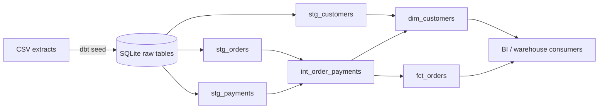

# Retail Revenue Pipeline

A compact analytics-engineering project that turns raw commerce extracts into
tested, documented decision tables. It runs locally on SQLite and keeps the dbt
layer intentionally portable to Snowflake.

## What this demonstrates

- Layered dbt modeling: raw seeds → staging views → intermediate logic → marts
- Data contracts expressed as dbt tests, including a custom business-rule test
- Incremental-friendly SQL patterns and clear model ownership/documentation
- A reproducible local workflow that does not require cloud credentials



## Data

All customers, orders, and payments in this repository are synthetic. They were
created only to make the pipeline reproducible and contain no company or customer
data.

## Verified local setup

The workflow below was verified on Windows with Python 3.12.14 in a project-local
environment named `.venv312`. It does not require cloud services, credentials, or
API keys.

From PowerShell, set the two clearly labeled placeholders below, open the project
directory, and create the environment with an existing Python 3.12 interpreter:

```powershell
# PLACEHOLDER: absolute path to this project directory
$projectRoot = '<PATH_TO_RETAIL_REVENUE_PIPELINE>'

# PLACEHOLDER: absolute path to a Python 3.12 executable
$python312 = '<PATH_TO_PYTHON_3.12_EXE>'

Set-Location $projectRoot
& $python312 -m venv .venv312
& '.\.venv312\Scripts\python.exe' -m pip install -r '.\requirements.txt'
```

Run the source-contract tests:

```powershell
& '.\.venv312\Scripts\python.exe' -m unittest discover tests -p 'test_*.py' -v
```

Run the complete pipeline. Prepending the environment's `Scripts` directory makes
sure the runner's `dbt` subprocesses also come from `.venv312`:

```powershell
$venvScripts = (Resolve-Path '.\.venv312\Scripts').Path
$env:PATH = "$venvScripts;$env:PATH"
& '.\.venv312\Scripts\python.exe' '.\scripts\run_pipeline.py'
```

The runner creates `warehouse/analytics.db`, executes `dbt seed`, `dbt run`, and
`dbt test`, then prints a revenue preview.

### Verified results

The local verification completed successfully with:

- 3 of 3 Python source-contract tests passing
- 3 of 3 dbt seeds loading successfully
- 6 of 6 dbt models building successfully
- 30 of 30 dbt data tests passing
- 5 customers, 7 orders, and 8 payment events in both the raw and cleaned layers

The final order fact contains 7 rows. Completed orders produce `569.99` in
recognized revenue; pending and returned orders produce `0.00`.

### Blank-record fix

The original seed files ended with two newline characters. The first ended the
last legitimate record, while the second was interpreted by dbt-sqlite as an
empty record and produced an all-null row. The extra blank line was removed from
each CSV. Every legitimate synthetic record was preserved, and no test or
business rule was weakened.

To generate browsable dbt lineage and model documentation after activating or
adding `.venv312\Scripts` to `PATH`, run:

```powershell
dbt docs generate --profiles-dir .
dbt docs serve --profiles-dir .
```

## Production migration: Snowflake

The model SQL avoids SQLite-only extensions and keeps warehouse concerns in the
profile. For Snowflake, install `dbt-snowflake`, define a Snowflake target using
environment variables or a secrets manager, and replace the local CSV seeds
with source declarations for landed tables. In production I would also:

1. Materialize staging as views and marts as tables or incremental models.
2. Use separate `RAW`, `ANALYTICS_DEV`, and `ANALYTICS_PROD` schemas.
3. Run `dbt build` in CI on pull requests and scheduled production jobs.
4. Add freshness checks to raw sources and alerts for failed tests.
5. Grant downstream roles access only to curated marts.

The included sample data is synthetic and exists only to make the project fully
reproducible.

