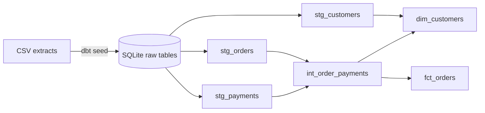

# Retail Revenue Pipeline

This is an AI-assisted learning project that brings fictional customer, order,
and payment records together into two reports: one row per order and one summary
per customer. It runs locally using Python, SQL, dbt, and SQLite.

I chose this project because it seemed business-oriented and applicable to
different businesses. AI helped write the code. With guidance, I ran the pipeline
and checked its results against the original records. I’m continuing to develop
my understanding of the SQL, dbt workflow, and tests.

## What the pipeline does

- Loads three CSV files into SQLite using dbt seed.
- Cleans IDs, dates, text, and amounts in staging views.
- Groups payments by order before joining them to orders, so multiple payments
  don’t become multiple orders.
- Builds fct_orders and dim_customers.
- Runs data-quality checks and prints a revenue summary through Python.



## Data

All customers, orders, and payments in this repository are synthetic. They were
created only to make the pipeline reproducible and contain no company or customer
data.

## Revenue rule and limitations

For this learning exercise, completed orders count their net payment amount as
revenue. Pending and returned orders count as zero. This is a simple exercise
rule, not a complete accounting model.

Order 1007 has two payments, $40 and $15, totaling $55 for one order. Returned
order 1003 contains a refund of $45, but its original positive payment is absent
from the sample.

The dataset contains only 5 fictional customers, 7 orders, and 8 payment events.
It does not provide complete refund tracking, product analysis, business
expenses, or company cash flow. There is no automatic ingestion, scheduler,
incremental processing, dashboard, or production deployment. Passing tests
checks the rules implemented; it does not guarantee that the data is complete
or every business rule is correct.

No Snowflake deployment, CI workflow, or downstream BI integration was
implemented or verified.

## Verified local setup

The reported full run was verified in the original Windows working folder with
Python 3.12.14 in a project-local environment named `.venv312`. A fresh checkout
of this standalone repository has not been independently run. The local workflow
does not require cloud services, credentials, or API keys.

From PowerShell, set the two clearly labeled placeholders below, open the project
directory, and create the environment with an existing Python 3.12 interpreter:

```powershell
# PLACEHOLDER: absolute path to this project directory
$projectRoot = '<PATH_TO_RETAIL_REVENUE_PIPELINE>'

# PLACEHOLDER: absolute path to a Python 3.12 executable
$python312 = '<PATH_TO_PYTHON_3.12_EXE>'

Set-Location $projectRoot
& $python312 -m venv .venv312
& '.\.venv312\Scripts\python.exe' -m pip install -r '.\requirements.txt'
```

Run the source-contract tests:

```powershell
& '.\.venv312\Scripts\python.exe' -m unittest discover tests -p 'test_*.py' -v
```

Run the complete pipeline. Prepending the environment's `Scripts` directory makes
sure the runner's `dbt` subprocesses also come from `.venv312`:

```powershell
$venvScripts = (Resolve-Path '.\.venv312\Scripts').Path
$env:PATH = "$venvScripts;$env:PATH"
& '.\.venv312\Scripts\python.exe' '.\scripts\run_pipeline.py'
```

The runner creates `warehouse/analytics.db`, executes `dbt seed`, `dbt run`, and
`dbt test`, then prints a revenue preview.

### Verified results

That run in the original Windows working folder completed successfully with:

- 3 of 3 Python source-contract tests passing
- 3 of 3 dbt seeds loading successfully
- 6 of 6 dbt models building successfully
- 30 of 30 dbt data tests passing
- 5 customers, 7 orders, and 8 payment events in both the raw and cleaned layers

The final order fact contains 7 rows. Completed orders produce `569.99` in
recognized revenue; pending and returned orders produce `0.00`.

### Blank-record fix

The original seed files ended with two newline characters. The first ended the
last legitimate record, while the second was interpreted by dbt-sqlite as an
empty record and produced an all-null row. The extra blank line was removed from
each CSV. Every legitimate synthetic record was preserved, and no test or
business rule was weakened.

To generate browsable dbt lineage and model documentation after activating or
adding `.venv312\Scripts` to `PATH`, run:

```powershell
dbt docs generate --profiles-dir .
dbt docs serve --profiles-dir .
```
